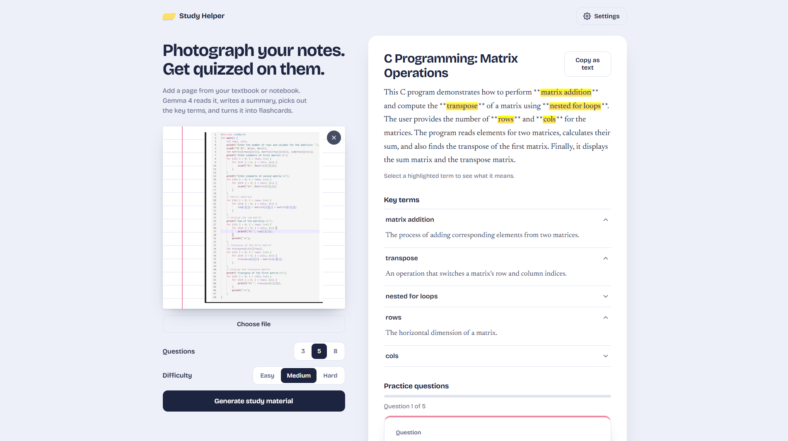

# Study Helper

Photograph a textbook page or handwritten notes and get a **summary**, **key terms**, and **flashcards** in seconds. Built for Hacktoberfest Hack Day (Greater Noida x FOSS Club Bennett University) in the **Best Use of Gemma 4** category.



## How it uses Gemma 4

The app sends your photo and a structured prompt to **Gemma 4**, an open-weight multimodal model, through the Gemini API. Gemma 4 reads the text and diagrams in the image and returns JSON. The app turns that JSON into:

- a summary with the key terms highlighted by an animated marker
- a glossary you can open term by term
- flip-style flashcards you grade yourself, with a score at the end

Supported models: `gemma-4-26b-a4b-it` and `gemma-4-31b-it`.

## Features

- Drag and drop, paste, choose a file, or take a photo on your phone
- Large photos are resized in the browser before upload
- Review only the questions you missed
- Copy the whole result as plain text
- Works with keyboard and screen readers, and respects reduced-motion settings

## Run it

This is a plain HTML, CSS, and JavaScript site. There is nothing to install and no build step.

1. Get a free API key from [Google AI Studio](https://aistudio.google.com/apikey).
2. Start a local server in this folder:
   ```bash
   python -m http.server 8000
   ```
3. Open <http://localhost:8000>, click **Settings**, paste your key, and save.
4. Add a photo of your notes and click **Generate study material**.

Your key is stored only in your browser (`localStorage`) and is sent only to Google's Gemini API. It is never part of the code or this repository.

## Deploy with GitHub Pages

1. Push this folder to a public GitHub repo.
2. In the repo, open **Settings > Pages**, set the source to the `main` branch and the root folder, and save.
3. After a minute your live site appears at `https://YOUR_USERNAME.github.io/REPO_NAME/`.

## Project structure

| File | Purpose |
| --- | --- |
| `index.html` | Page structure |
| `style.css` | Design and animations |
| `helpers.js` | Pure functions: prompt, JSON parsing, term highlighting |
| `script.js` | Upload, API call, results, flashcards |

## Contributing

Contributions are welcome. Ideas: multi-page uploads, flashcard export, more languages, saved study history. Open an issue or a pull request.

## License

MIT. See [LICENSE](LICENSE).
